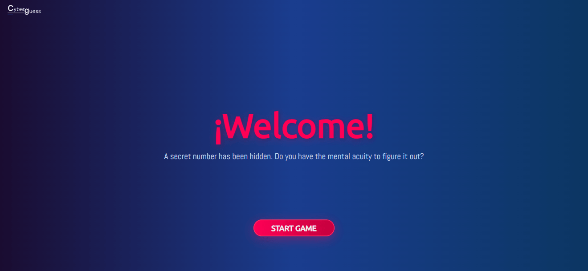
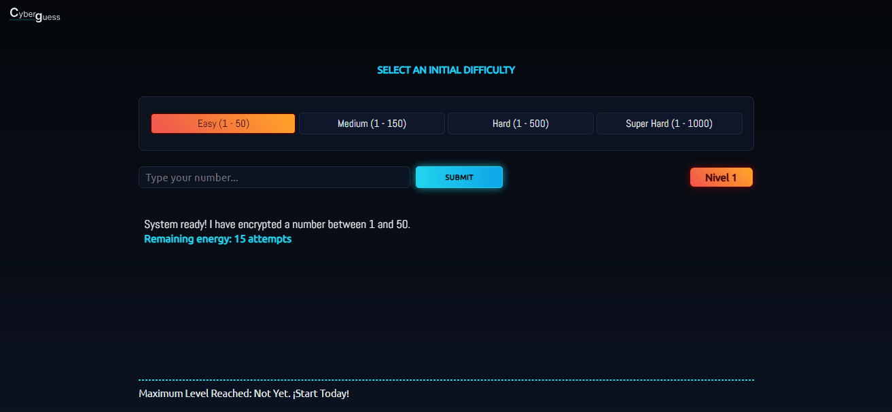
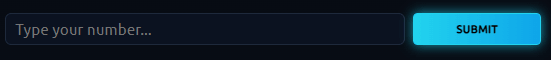
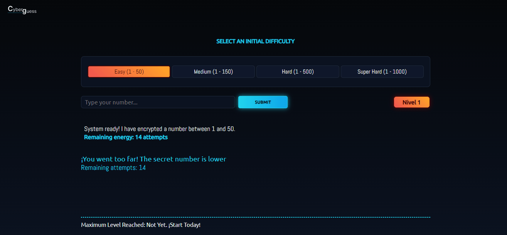
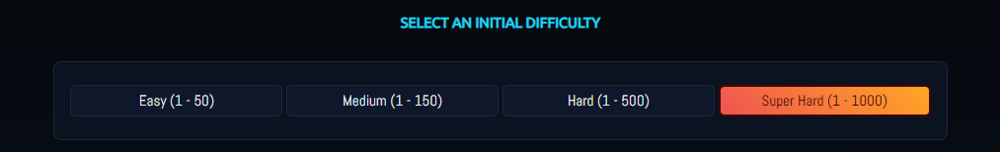

# 🔢 Secret Number

This project was developed with HTML5, CSS3, and JavaScript. It lets users guess a hidden number by following progressive clues, which helps the user combine mathematical, logical, and collaborative reasoning.

## Features

- **Start Game:** Allows the user to start the game.  
- **Hint:** Indicates if the number is even or odd, higher or lower than the others.  
- **Turns:** Each hint reveals one possibility.  
- **Attempts:** Lets the user know how many tries are left to guess the secret number.  
- **Winning:** Once the user has guessed the secret number, the current level is increased and the remaining attempts are added to the new attempts.  
- **Difficulties:** The game has 4 difficulty levels, each with a different number of attempts.
- **User-friendly interface:** Simple and easy-to-use design.

## Technologies Used

**Developer tools**

- [HTML5](https://developer.mozilla.org/en-US/docs/Web/HTML): Application structrue.
- [CSS3](https://developer.mozilla.org/en-US/docs/Web/CSS): Interface styling.
- [JavaScript](https://developer.mozilla.org/en-US/docs/Web/JavaScript): Application logic.

**Souce code editor**

- [VSCode](https://code.visualstudio.com)
- [Antigravity](https://antigravity.google.com)

**AI resources**

- [Gemini](https://gemini.google.com)
- [VSCode Copilot](https://code.visualstudio.com/docs/copilot/overview)

**Tool**

- [Git](https://git-scm.com)
- [GitHub](https://github.com)

## 🚀 Installation

### Prerequisites

- [Node.js](https://nodejs.org/) (v16 or higher): only needed if you want to run unit tests.
- [npm](https://www.npmjs.com/): it's usually installed together with Node.js or
- [npmp](https://pnpm.io/): installation speeds safer way to manage dependencies, an alternative to use.

### Steps to Install and Run

1. Clone this repository:
  ```bash
  git clone https://github.com/your-username/todo-list-js.git
  ```
2. Navigate to the project directory:
  ```bash
  cd todo-list-js
  ```
3. Open the main file in your browser:
- Open the `index.html` file in your browser.

### (Optional) Install Dependencies and Run Test

If you want to run automated tests:

4. Install dependencies: _npm install_.
5. Run unit tests: _npm test_.

## 🧹 Code Formatting

This project uses [Prettier](https://prettier.io) to keep code style consistent across the repository.

You can use Prettier in two ways:

### 1. Using the Prettier extension in your editor (recommended for VSCode)

- Install the "Prettier - Code formatter" extension from VSCode marketplace.
- Configure your editor to use the project's `.prettierrc` file and format code automatically on save.
- This ensures your code follows the same styles as the rest of the project.

### 2. Using Prettier as a project dependency

- If you want to sure everyone uses the same Prettier version, install it locally: `npm install prettier --save-dev`.
- To format all code in the project, run `npx prettier --write`.
- This guarantees that formatting is identical for all contributors, regardlesss of their editor setup.

### Notes

- The project's Prettier configuration can be found in the `.prettierrc`file.
- If you're contributing, please format your code before committing to avoid conflicts and maintain consistency.

## 🛠️ Usage

To run the project, you can use the following commnad if you use a dependency.

```bash
npm start
```
Or open the main (`index.html`) file in your browser.

Once you have opened the project in the browser, you can follow the these steps:

1. Press the `Start Game` button to start the game.
2. Type a number in the input field to know if you guessed or not the secret number.
3. Choose any of the difficulty levels.

> **NOTE**: To understand the working logic of the secret number in detail (how items are stored), you can refer to the source code in the `hooks/storage.js` file.

## 🤝 Contributing

Thank you for your interest in contributing. To streamline the review and increase the chances of merging, please follow these guidelines:

### 1) Workflow

- Fork the repository and create a descriptive branch from `main`, for example:
  - `feat/responsive-board`
  - `fix/reset-icons-error`
- Keep your branch updated with `main` before opening a PR (rebase or merge as you prefer).

### 2) Commit Messages

- Use Conventional Commits:
  - `feat:`, `fix:`, `chore:`, `docs:`, `test:`, `refactor:`.
- Examples:
  - `fix: handle 'icons is not iterable' in reset`
  - `feat: centralize icons in states`

### 3) Pull Requests

- Open a PR against `main` with a clear description of the change and the justification.
- Include steps to reproduce or verify (commands, screenshots if applicable).
- Reference an issue where applicable (for example, `Closes #12`).

### 4) Minimum Review List

Before requesting a review, make sure that:

- The change was tested manually (the application loads and the changed behavior works).
- If you add automated tests, run them locally.
- If your project has a file `CHANGELOG.md` under `Unreleased` for notable changes, update it with the new parameters of your project.

### 5) How to Run Tests Locally

- Install dependencies (if any): `npm install`.
- Open `index.html` in a browser for manual testing.

### 6) CI and Quality

- The project uses GitHub Actions to perform a basic check.
- If you want, I can add linters and test runners (I can implement them upon request).

### 7) Code Style

- Use modern JavaScript (ES modules), small pure functions, and single-responsibility files.
- Use descriptive names and add comments where the intention is not obvious.

### 8) Communication

- For significant or design changes, open an issue to discuss first.

Thank you for contributing, all contributions are welcome and will be carefully reviewed.

Don't forget to follow the code formatting guidelines above.

## 🧱 Project Structure

```
└── 📁secret-number
    └── 📁node_modules
    └── 📁src
        └── 📁__tests__
        └── 📁_fns
        └── 📁assets
            └── 📁css
            └── 📁icons
            └── 📁images
        └── 📁handlers
        └── 📁helpers
        └── 📁hooks
        └── 📁js
        └── 📁modules
        └── 📁ui
        └── 📁utils
        └── 📁variables
    └── .gitignore
    └── .babel.config.cjs
    └── favicon.ico
    └── index.html
    └── jest.config.js
    └── package.json
        └── pnpm-lock.json
    └── README.md
    └── LICENSE
```

## 🏗️ Modular File Architecture

- `assets/`: Images and icons.
- `css/`: Main style sheet.
- `js/`: Main script input.
- `modules/`: Modular logic of the player (controllers, fetch, progress logic).
- `_fns/`: Utilities functions and helps.

## ✅ States and Key Features

- **Start game**: Begins a new round with a hidden number.
- **Hints**: Indicate whether the secret number is higher or lower, and whether it is even or odd.
- **Attempts**: Show how many guesses remain.
- **Levels**: Increase the challenge after each successful round.
- **Winning state**: Adds the remaining attempts to the next round.
- **Reset game**: Restarts the current game.

## 🔧 Recent Changes and Improvements

Many changes were made to the secret number to make it more maintainable:

- Session saving to preserve levels
- User interface improvements
- Game logic improvements
- Performance improvements
- Accessibility improvements

## 🔮 Future Features

- Add dark mode
- Add more game modes
- Show confirmation modal before exiting or abandoning the secret number game

## 📁 Relevant Files

- `modules/startRound.js` — manages the round of the secret number.
- `modules/template.js` - manages the loading HTML structure.
- `variables/globals.js` — stores variables of HTML elements.
- `variables/constants.js` - stores constant variables, that will not change their value.
- `handlers/gameControllers.js` - stores the controllers of the game like (handleSubmit, handleGameConfiguration).

## ▶️ How to Run Tests Locally

- Open `index.html` in a browser and play.
- Commit changes to save them.
- Push changes to activate GitHub Actions verification:
  ```bash
  git push
  ```

## 🧪 Tests

This project includes unit tests located in the `__tests__` folder. The following examples are not part of this project, they are taken as a references to be used in this file:

- **`addTodo.test.js`**: Verifies the functionality of adding tasks.
  ```javascript
  const { addTodo } = require('../src/taskManager');

  test('should add a new task to the list', () => {
    const tasks = [];
    const newTask = 'Buy groceries';
    const updatedTasks = addTodo(tasks, newTask);
    expect(updatedTasks).toContain(newTask);
  });
  ```

- **`deleteTodo.test.js`**: Ensures tasks are correctly removed from the list.
  ```javascript
  const { deleteTodo } = require('../src/taskManager');

  test('should delete a task from the list', () => {
    const tasks = ['Buy groceries', 'Clean the house'];
    const taskToDelete = 'Buy groceries';
    const updatedTasks = deleteTodo(tasks, taskToDelete);
    expect(updatedTasks).not.toContain(taskToDelete);
  });
  ```

To run the tests, use the following command:

```bash
npm test
```

If you installed jest as a *Dev Dependencies* in your project, you can use the following command to run the tests.

```bash
npx jest
```

To see the complete test code, please go to the corresponding file in this project.

## ¿What is JSDoc?

[JSDoc](https://jsdoc.app) is a JavaScript documentation that uses tags to describe additional information about parameters and their return value, also a powerful tool for documenting JavaScript code.

Not only do they help other developers understand how to use your code, but they can also be used to generate automatic documentation.

Some of the advantages of using JSDoc tags are:

- Improves code readability.
- Makes the code easier to understand to other developers.
- Allows automatic documentation generation.
- Helps detect errors and inconsistencies in the code.
- Improve team collaboration.
<small style="font-size: .65rem">[META]</small>

Some of the most common JSDoc tags are: 

- @function
- @description
- @param
- @returns 

### Basic Syntaxis

```js
  /**
   * 
   * Description of the function
   * @param { type } nameOfParam: description of parameter
  */

 function myFunction(nameOfParam){
  // code goes here
 }
```

### Explanation

- __@function:__ refers to a function and usually used in conjunction with the function name.
- __@description:__ indicates detailed information about the functions, variables, classes or methods that are documented.
- __@param:__ is a tag used in function and method documentation to be describe the parameters that are passed to functions.
- __{ type }:__ specifies the data type of parameter, for example (string, number, object) etc.
- __@returns:__ is a tag used to describe the return value of a function.
- __nameOfParam:__ is the name of parameter.

### Example

```js
  /**
   * 
   * @function sum
   * @description: calculate the sum of two numbers
   * @param { number } a: return the value of a
   * @param { number } b: return the value of b
   * @returns { number } return the sum of a and b
  */

  function sum(a, b){
    return a + b
  }
```

The following functions described below use JSDoc tags to discribe the purpose of each function and the parameters these function receive.

The JSDoc is not available in the examples below, but you can see them in the repository.

## Debounce

The ```debounce()``` function forces a function to wait a few times before running the execution and preventing from being called several times.

```js
  function debounce(fun, wait = 0, immediate = false){
    let timer;
    return function(...args){
      const context = this;
      let later = () => {
        if(!immediate){
          func.apply(context, args)
        }
      }
      const callNow = immediate && !timer;

      clearTimeout(timer);
      timer = setTimeout(later, wait);

      if(callNow){
        func.apply(context, args)
      }
    }
  }
```

## Snippet Code

### Structure

- HTML is responsible for adding the structure of a web page or website.
- In the `index.html` file, we find the basic structure of the secret number.

__HTML (`index.html`)__

```html
<!DOCTYPE html>
<html lang='en'>
<head>
  <!-- Basic Page Needs -->
  <meta charset='UTF-8'>
  <meta name='description' content=''>
  <meta name='author' content=''>
  <meta http-equiv='X-UA-Compatible' content='IE=edge'>
  <!-- Mobile Specific Metas -->
  <meta name='viewport' content='width=device-width, initial-scale=1.0'>
  <title>Secret Number</title>
  <!-- Fonts -->
  <link rel='stylesheet' href='https://fonts.googleapis.com/css2?family=Abel&family=Play&display=swap'>
  <!-- CSS -->
  <link rel='stylesheet' href='https://cdnjs.cloudflare.com/ajax/libs/font-awesome/6.4.0/css/all.min.css'>
  <link rel='stylesheet' href='./src/assets/css/styles.css'>
  <script type="importmap">
    {
      "imports": {
        "_fns/": "./src/_fns/",
        "helpers/": "./src/helpers/",
        "handlers/": "./src/handlers/",
        "hooks/": "./src/hooks/",
        "modules/": "./src/modules/",
        "ui/": "./src/ui/",
        "utils/": "./src/utils/",
        "variables/": "./src/variables/"
      }
    }
  </script>
</head>
<body>
  <div class='container'>
     <div class='container'>

    </div>
    <script src='src/js/main.js' type="module"></script>
</body>
</html>
```

### Styles

- CSS styles are responsible for transforming the user interface __(UI)__ of a web page or website to make it pleasing to the eye of the user or end users.
- The `styles.css` file contains the styles used to modify the UI of the Secret Number. This includes the buttons (start game and submit), inputs (number), difficulty buttons, guides, etc.

__CSS (`css/styles.css`)__

```css
.container {
  height: var(--dvh);
  overflow: auto;

  .splash--screen {
    grid-template-columns: 1fr;
    grid-template-rows: repeat(3, 1fr);
    place-items: center;
    position: absolute;
    inset: 0;
    width: var(--sz);
    height: var(--dvh);
    background: var(--splash-gradient);
    z-index: 10;

    .splash--info {
      flex-direction: column;
      grid-row: 2;

      .title {
        color: var(--clr-accent);
        font-weight: 800;
        font-size: calc(var(--fnt-sz) * 5);
        margin-block-end: calc(var(--pd) * .75);
        text-shadow: 0 .25rem 1.125rem hsl(340, 100%, 50%, .25), .125rem .125rem .5rem rgba(0, 0, 0, .18);
      }

      .info {
        color: var(--clr-gray);
        font-family: var(--fnt-primary);
        font-size: calc(var(--fnt-sz) * 1.25);
      }
    }

    .start--btn {
      grid-row: 3;
      width: var(--sz);
      max-width: fit-content;
      height: 2rem;
      padding-inline: calc(var(--pd) * 2.25);
      padding-block: calc(var(--rd) * 2);
      font-size: calc(var(--fnt-sz) * 1.125);
      text-transform: uppercase;
      background: var(--star-btn-gradient);
      border-radius: calc(var(--pd) * 4);
      box-shadow: 0 .375rem 1.5rem hsl(340, 100%, 50%, .37), 0 0 0 .1rem #FF3366 inset;

      &:active { scale: .98 }
    }
  }

  .main {
    grid-template-columns: repeat(6, 1fr);
    grid-template-rows: repeat(8, 1fr);
    place-items: center;
    height: var(--dvh);
    background: var(--bg-gradient);
    container-type: inline-size;

    :is(.hud, .form--container, .footer) {
      grid-column: 2 / 6;
      min-width: min(var(--sz), 60rem)
    }

    :is(.game--info__container, .alert) { grid-column: 2 / 6; }
    :is(.hud, .input--field, .difficulty--btn, .submit--btn, .level--container) { border-radius: calc(var(--rd) * .75) }
    :is(.difficulty--section, .form--container, .game--info__container, .alert) { width: var(--sz) }
    :is(.submit--btn, .level--container, .input--field) { height: 2rem }

    .difficulty--info {
      grid-row: 2;
      grid-column: 1 / -1;
      text-transform: uppercase;
      font-size: calc(var(--fnt-sz) * .95)
    }

    .hud {
      grid-row: 3;
      background: var(--clr-hud);
      width: var(--sz);
      height: var(--sz);
      padding: calc(var(--fnt-sz) * .5) calc(var(--fnt-sz) * 1.05);

      /* More code here */
    }

    /* More code here */
  }
}

```

### Functionality

- JavaScript is responsible for providing interactivity or funcionality to a web page or website.
- The `index.js` file is responsible for initializing the To-Do list.

__JavaScript (`js/main.js`)__

```js
import { template } from 'modules/template.js';
import { startRound } from 'modules/startRound.js';
import { states } from 'variables/constants.js';

document.addEventListener('DOMContentLoaded', () => {
  template();

  function startGame(){
    states.gameStarted = true;
    startRound();
  }

  // More code here
})
```

## (UI/UX) Design

### ¿What is UI/UX Design?

- UI (User Interface): refers to the visual appearance of an application or website, including elements such as buttons, menus, colors and fonts.

- UX (User Experience): focuses on the user's experience when interacting with an application, from ease of use to overall satisfaction.
<small style="font-size: .65rem">[GEMINI]</small>

### (UI/UX) Design Explanation

1. __Splash screen:__

To start the game, you must to press the 'Start Game' button; this action closes the screen and launches the Secret Number game.



2. __Init game:__

Once the splash screen is closed, you can start the game by typing a number of your choice into the input field.




3. __Input field:__

An input field allows us to enter information or a task, a number to be added to a list, when the "Add or submit" button is pressed.



4. __Alert message:__

_There is an important point to note_: if the input field does not contain a task or a number, it shows a message to let you know you have to add a number or task.

A message will appear informing the user that the input field must not be empty. Once the information window is closed, the user can re-enter the task or add a nummber and go ahead.



5. __Difficulty section:__

You can choose any difficulty level; each one has a maximum number of attempts and specific challenges.



## 🗎 License

This project is licensed under the MIT License. See the `LICENSE` file for more details.