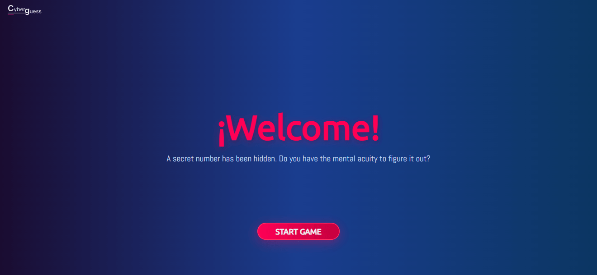
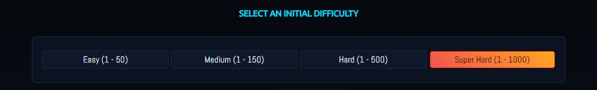
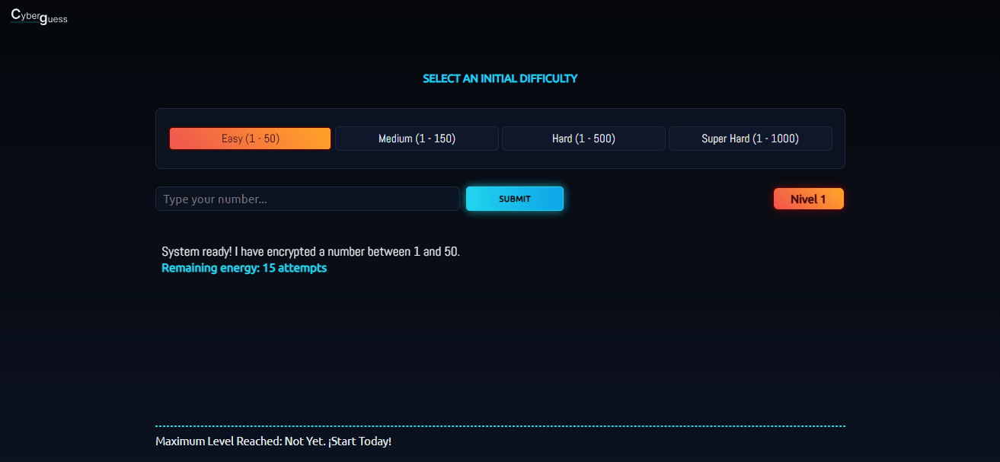
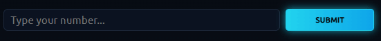
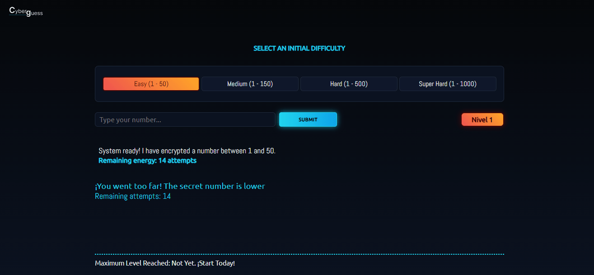

# Secret Number

[English](README.md) | **Español**

Juego web en el que adivinas un número secreto dentro del rango de la dificultad elegida. Después de cada respuesta incorrecta, el juego indica si el número secreto es mayor o menor.

## Cómo jugar

1. Selecciona una dificultad.
2. Pulsa **Start Game** e ingresa un número dentro del rango indicado.
3. Usa las pistas y el contador de intentos restantes para encontrar el número.
4. Al acertar, avanzas al siguiente nivel. El botón de reinicio vuelve al primer nivel y borra el récord guardado.

| Dificultad | Rango inicial | Intentos iniciales |
| --- | ---: | ---: |
| Fácil | 1–50 | 15 |
| Media | 1–150 | 10 |
| Difícil | 1–500 | 7 |
| Súper difícil | 1–1000 | 5 |

Actualmente, cada nivel aumenta el límite superior del rango en 30 y añade un intento; la progresión no tiene un límite configurado. El récord de nivel se guarda en el `localStorage` del navegador.

## Interfaz de usuario

### Pantalla de bienvenida

La pantalla inicial presenta el juego y permite comenzar con el botón **Start Game**.



### Selección de dificultad

Elige una de las cuatro dificultades. La opción seleccionada queda resaltada antes de hacer una jugada.



### Pantalla del juego

La pantalla muestra la dificultad seleccionada, el campo de entrada, el nivel, el rango del número y los intentos restantes.



### Campo para ingresar el número

Escribe un número en el campo y envíalo para recibir una pista.



### Pista e intentos restantes

Si la respuesta es incorrecta, aparece un aviso que indica si el número secreto es mayor o menor y muestra cuántos intentos quedan.



## Ejecutar localmente

La aplicación no requiere compilación. Sirve la carpeta raíz con un servidor HTTP local, por ejemplo, la extensión Live Server de VS Code, y abre `index.html`. También puedes ejecutar:

```bash
python -m http.server 8000
```

Luego visita <http://localhost:8000>.

Para instalar las dependencias de desarrollo y ejecutar las pruebas:

```bash
pnpm install
pnpm test
```

## Estructura del proyecto

```text
src/
├── __tests__/   Pruebas automatizadas
├── assets/      Estilos, iconos e imágenes
├── handlers/    Manejadores de eventos del juego
├── helpers/     Configuración de dificultades
├── hooks/       Persistencia del récord y del tema
├── modules/     Plantilla e inicio de rondas
├── ui/          Notificaciones
├── utils/       Utilidades compartidas
└── variables/   Estado y referencias al DOM
```

El punto de entrada de la aplicación es `src/js/main.js`; la página HTML es `index.html`.

## Documentación y licencia

La [Guía de Mejoras](./GUIA_DE_MEJORAS.md) contiene propuestas y ejemplos de implementación. Esas mejoras todavía no están incluidas en el juego.

El proyecto se distribuye bajo la [licencia MIT](./LICENSE).
